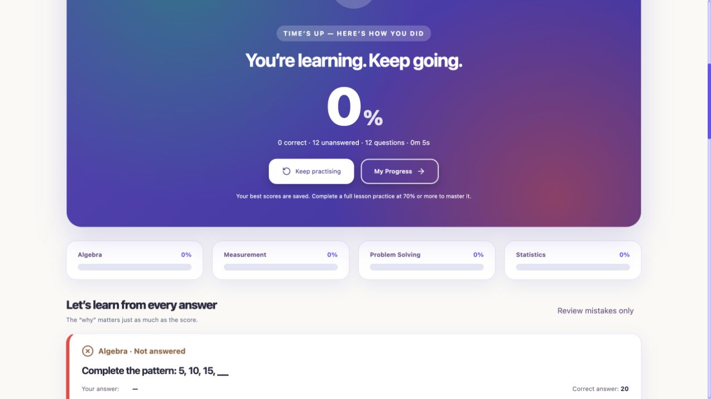

# Quiz inspection and test report

Date: 16 October 2026

## Scope and environment

Inspected the existing practice/mock-test pages, quiz runner, request helper, session cache, dialog, server question bank, grading controller and progress writes. Preserved the user's existing change to `Client/src/component/Learning/SubjectLessons.jsx` and did not edit tutor streaming code.

Browser checks used the actual production client build and actual practice controller in the Codex in-app browser, with an isolated Grade 4 profile and an in-memory Prisma fixture. Test fixtures supplied deterministic question order and controlled loading/save failures. No live PostgreSQL records, accounts, migrations or AI services were changed.

## Issues found and fixed

| Issue | Exact cause | Fix and verification |
| --- | --- | --- |
| Starting a quiz crashed the page | `practiceRequest` was used without an import in `QuizRunner.jsx`. A production build still succeeded. | Restored the import. Reproduced the original `ReferenceError` in the browser, then loaded and completed repaired quizzes. |
| Corrupt saved data could crash rendering | Cache restoration trusted answer types, flags, index and question payloads. Numbers were passed to `.trim()` and non-arrays to `.includes()`. | Added shared validation/sanitisation; only valid mode-specific attempts can resume. Regression tests cover corrupted JSON, disabled storage, invalid answer/flag shapes, duplicate/empty questions, invalid indices, expiry and wrong modes. |
| Results disappeared after refresh | Successful submission removed the session cache and kept the result only in component state. | Cache a validated result with the attempt. Both pages offer “View last result”. Verified by a real browser reload. |
| A hanging request could leave the quiz stuck | Requests had no timeout. | Added a 20-second timeout, cancellation cleanup and recoverable errors. Tested stalled requests, retry, aborts and malformed/null responses with mocked fetch/timers. |
| Retrying could use changed answers after an uncertain save | Inputs unlocked after an error even though the original request might already have committed. Submission state was not restored. | Freeze the submitted answers, preserve submission state across refresh, and retry the same attempt. Browser-tested a failed save, reload and successful retry with all six wrong answers. A separate lost-response browser scenario was interrupted and is not counted as passed. |
| Invalid numeric text appeared answered | Any nonblank string counted as answered and could be submitted manually. | Validate decimal/signed numbers and actual MCQ choices, show an inline error, focus the invalid question, and block manual submission until corrected or cleared. Timer expiry can still submit invalid answers as wrong. Tested invalid text in the browser and numeric edge cases in unit tests. |
| Timer display depended directly on the device clock | The browser compared its own timestamp with a server-generated deadline. | Include server time/expiry and preserve a clock offset; use an absolute deadline rather than decrementing a counter. Unit-tested clock offsets/zero bounds and browser-tested normal countdown, refresh and expiry. Network latency still limits clock synchronisation precision. |
| Starting another attempt silently replaced unfinished work | New practice/test buttons did not check the saved unfinished attempt. | Add a replacement confirmation for each mode. Browser-tested mock-test cancellation and confirmed replacement. |
| Refresh was unnecessarily blocked | `beforeunload` always cancelled navigation despite a successfully saved draft. | Warn only when the draft cannot be saved; verified real reload with answer, flag and current-question restoration. |
| Result text and buttons were unreadable | Shared `.practice-app` styles and `!important` button colours overrode the quiz result gradient's intended foreground colours. | Scoped readable result colours, darkened the existing gradient and restored button labels. Verified visually; screenshot below. Also added visible keyboard focus for hidden radio inputs. |

Navigation is clamped to valid indices. All question-navigation controls are disabled during submission. Start/result responses are validated before rendering, and asynchronous start callbacks ignore cancelled requests. Expired quiz tokens are distinguished from expired login sessions so an expired attempt does not unnecessarily redirect to login.

## Browser checks actually completed

| Feature/scenario | Observed result |
| --- | --- |
| Initial question load | Six practice questions loaded after fixing the missing import. |
| Numeric and MCQ selection | Entered numeric answers; changed a correct MCQ selection to an incorrect one and verified only the new option remained selected. |
| Next/Previous | Question numbers changed correctly; previous answers persisted; Previous was disabled on question 1. |
| Question map and final question | Jumped to question 6 and question 20; final questions showed Finish rather than Next. |
| Hints and review flags | Hint toggled; flag persisted across navigation and refresh; mock tests did not expose practice hints. |
| Cancel submission | “Keep working” returned to the existing answers without saving. |
| Mixed practice answers | 1 correct, 1 incorrect, 4 blank: 17%, correct explanations and 4 unanswered. |
| All correct | 6/6: 100%, no mistake cards, “All correct” message. |
| All incorrect | 0/6 with all questions answered: 0%, 0 unanswered and six wrong-answer explanations. |
| All unanswered | 20-question mock: 0%, 20 unanswered and 20 review cards. |
| Repeated Submit | Double-clicked confirmation during an artificially delayed save; server event log showed one submission/save for that attempt. |
| Draft refresh | Real reload restored the selected question, numeric/MCQ answers and flag. |
| Result refresh | Real reload exposed View last result and recovered the 17% result. |
| Normal mock settings | 12 questions/12:00 and 20 questions/20:00; question-map counts matched. |
| Mock refresh | Timer stayed at the original remaining time rather than resetting to 12:00; answer and flag survived. |
| Automatic completion | A signed five-second test deadline produced a time-up result automatically: 0 correct, 12 unanswered, elapsed 5s, with answer controls removed. This exercises the timer mechanism without waiting 12 minutes. |
| Loading failure | Controlled HTTP 503 displayed a recoverable loading error and Back to lessons. |
| Save failure and retry | Controlled HTTP 503 preserved answers; refresh restored the frozen pending submission; retry succeeded. |
| Saved progress | Dashboard showed 100% best score, one mastered lesson and the expected two attempts after mixed + perfect practice. Lower scores retained the existing best score in automated tests. |
| Visual result display | Result text and both buttons became readable after the CSS fix. |

The baseline browser console contained the reproduced missing-import ReferenceError. No replacement JavaScript exception appeared during the completed repaired flows. Controlled HTTP/network failures were intentionally produced; this is not a claim that every page in the app has a clean console. Browser automation itself developed stale-node/native-connection errors near the end, which are not counted as product failures or successful test coverage.

## Automated checks

- Client quiz suite: **13 passed** (`cd Client && npm test`). Covers input/session/result validation, cache recovery, clock calculations, request credentials, cancellation, timeout/retry and malformed responses.
- Server practice suite: **20 passed** (`cd server && node --test test/practice.test.js`). Includes all 288 answers independently recalculated from the displayed question prompts; exact mixed/blank/wrong scoring; 12/20-question subject balance; grade/account restrictions; signed/expired/forged tokens; mastery threshold; best-score preservation; duplicate and concurrent submissions; and retry after a simulated database failure.
- ESLint on quiz components and new client tests: **passed**.
- Production client build: **passed**. The initial broken build also passed, illustrating why build success alone was insufficient.
- Full project lint: **not clean**. Four existing errors remain in `TutorSession.jsx` (undefined `pendingRef`/`requestRef` and duplicate `signal`), outside the quiz scope.
- Full server suite: **32 tests, 23 passed, 9 failed**. All 20 practice tests passed; the nine failures are in the separate existing tutor controller tests. Those files were left unchanged.

## Limits and remaining risks

- Live PostgreSQL persistence, rollback behaviour, concurrent SQL execution and real login/session cookies were not exercised end to end. The tests verify calls and behavior using fixtures.
- Duplicate-submission protection is an in-memory map scoped to one backend process. Replays after a restart or across multiple instances require persistent attempt/idempotency storage; that architecture was not changed in this audit.
- The backend permits a 30-second submission grace period after a mock deadline. A disconnected or suspended tab resumed after that window cannot save that expired test. This is a learning tool, not a proctored exam system.
- Saved drafts/results are tab-local, account-scoped and expire after two hours. Storage-disabled behavior was unit-tested, not tested in an actual privacy-restricted browser.
- The browser interruption prevented completion of the separate “save committed but response lost” test. Automatic retry/duplicate behavior is covered by automated tests, but this particular UI scenario remains unverified.
- Mobile breakpoints, screen-reader behavior, other browser engines and long-duration background-tab throttling were not verified in this run. The timer's absolute-time calculation was unit-tested.
- This report verifies the listed cases; it does not certify every possible interaction or the entire application as fully functional.

